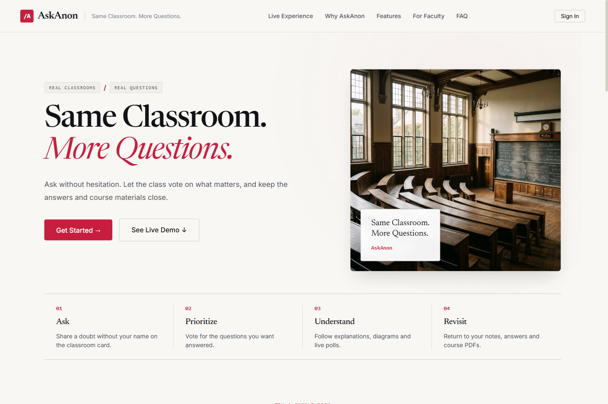
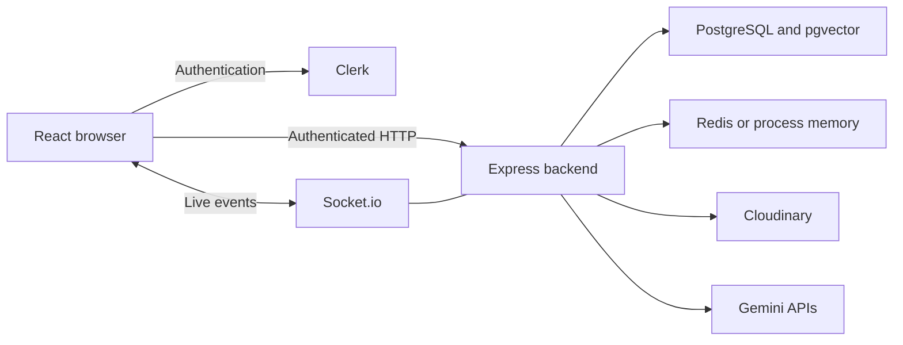

# AskAnon

**Same Classroom. More Questions.**

A real-time classroom Q&A platform that connects live discussion with after-class study. Students ask without displaying their names, teachers respond to the questions that matter, and a course companion answers questions using uploaded PDFs and retrieved evidence.

[Live demo](https://ask-anon-roan.vercel.app/) - [Project handbook](docs/knowledge/README.md) - [Local setup](docs/LOCAL_SETUP.md) - [Deployment](docs/DEPLOYMENT.md)



## Overview

AskAnon gives a lecture one shared question feed and a place to keep its answers and materials. It is designed for students and teachers without adding a university administration layer.

A person signs in, chooses **Student** or **Teacher** once, and returns to that saved workspace. Teachers manage their own sessions and courses. Students join with a six-character lecture code; joining a live course-linked session grants access to its course vault.

## Features

| During the lecture | After the lecture |
|---|---|
| Live questions, upvotes and duplicate-question suggestions | Read-only lecture recaps and recorded answers |
| Pin, answer, dismiss and pause question intake | Course vaults containing PDFs and saved diagrams |
| Written explanations, code snippets and shared images | Bookmarked questions for later revision |
| Polls with live results | PDF-grounded AI answers, follow-ups and generated practice |
| Context-aware checks for abusive or unrelated written questions | Source links and inspectable retrieved passages |

A session can start without a course. Uploading material or saving a diagram to its vault creates or reuses the teacher's general course and links the session. Courses group related lectures and resources; they do not require institutional enrollment management.

## AI that works with course material

AskAnon uses several distinct AI workflows:

- **Question moderation:** local checks and Gemini classification assess written submissions against lecture context before publication.
- **Duplicate suggestions:** normalized text matching and embedding similarity suggest existing active questions to upvote.
- **Course-vault RAG:** retrieved PDF passages supply evidence for generated answers.
- **Lecture insights:** selected discussion and polls produce structured recap guidance.

The RAG pipeline has two stages:

```text
PDF upload - page text extraction - bounded scanned-page transcription if needed
           - text chunks - 768-dimensional embeddings - PostgreSQL / pgvector

Student question - authorized course/material scope - semantic retrieval
                 - neighboring passages - Gemini answer - sources and evidence
```

Original files stay in Cloudinary. Chunk text, page metadata and vectors stay in PostgreSQL. Gemini generates explanations from selected excerpts; the application does not train a model on the PDFs. Overview/revision requests use sampled passages rather than claiming to read every page.

Read the [AI and RAG walkthrough](docs/knowledge/04-AI-AND-RAG-EXPLAINED.md) for the actual implementation, failure policies and limitations.

## Technology stack

| Layer | Technologies |
|---|---|
| Frontend | React 19, Vite, React Router, custom CSS |
| Backend | Node.js ES modules, Express 5 |
| Real-time communication | Socket.io |
| Identity | Clerk |
| Database | PostgreSQL, pgvector, Prisma 6.19.3 |
| Cache and counters | Redis with a bounded in-memory fallback |
| File storage | Cloudinary |
| AI | Gemini generation, classification and embedding APIs |

## Architecture



PostgreSQL holds durable state. HTTP handles most resource operations; socket rooms distribute classroom and private workspace updates. Reconnecting clients reload persisted state. The backend also runs PDF-indexing and cleanup work; lecture-deletion jobs are persisted for recovery.

## Run locally

### 1. Prerequisites

- **Node.js 22.18+ within Node 22**, npm and Git.
- PostgreSQL with the **pgvector** extension available, locally or through Supabase.
- A Clerk development application with matching frontend/backend keys.
- Cloudinary credentials for uploads; PDF delivery must be enabled for stored PDFs to be readable.
- A Gemini API key with access and quota for the configured models. Written question moderation and PDF AI require it.
- Redis is optional for local development. Without it, the backend uses process-local fallback state.

### 2. Clone and install

```sh
git clone https://github.com/vanshambansal/AskAnon.git
cd AskAnon
npm --prefix backend ci
npm --prefix frontend ci
```

### 3. Configure environment files

For a **new checkout**, copy the examples:

```sh
cp backend/.env.example backend/.env
cp frontend/.env.example frontend/.env
```

In Windows PowerShell, use `Copy-Item` in place of `cp` if needed. If the files already exist, edit them instead of overwriting them.

Set the backend values in [backend/.env.example](backend/.env.example):

| Configuration | Purpose |
|---|---|
| `DATABASE_URL`, `DIRECT_URL` | Runtime and administrative PostgreSQL connections |
| `CLERK_SECRET_KEY` | Backend identity verification |
| `CLOUDINARY_CLOUD_NAME`, `CLOUDINARY_API_KEY`, `CLOUDINARY_API_SECRET` | Material and image storage |
| `GEMINI_API_KEY` and model settings | AI checks, embeddings and generation |
| `REDIS_URL` | Optional shared cache/counters; leave empty if unused |
| `NODE_ENV`, `ALLOWED_ORIGINS` | Development mode and exact allowed browser origins |

Keep the example's local origin values for development. Choose models available to your key; an example model ID does not guarantee provider access or quota. Roles remain immutable even if an old `ALLOW_ROLE_SWITCH` value is present.

Set the frontend values:

```dotenv
VITE_API_URL=http://127.0.0.1:5000
VITE_CLERK_PUBLISHABLE_KEY=YOUR_CLERK_DEVELOPMENT_PUBLISHABLE_KEY
```

Use keys from the **same Clerk application**, configure localhost authentication/redirects, and keep the API URL free of an `/api` suffix. The default authentication return path is `/dashboard`.

Never commit real `.env` files. Variables prefixed with `VITE_` are browser-visible; do not put database passwords, Gemini keys or backend secrets there.

### 4. Prepare the database

**New, empty database only:** from the repository root, run:

```sh
cd backend
npx prisma db execute --schema prisma/schema.prisma --file prisma/baseline.sql
npx prisma generate
cd ..
```

The account must be able to enable pgvector, or an administrator must enable it first. The baseline creates AskAnon's tables; it is not a command for upgrading a populated database.

**Existing AskAnon database:** do not execute the baseline, reset the database or blindly replay historical migrations. Review [existing-database setup](docs/LOCAL_SETUP.md#existing-database-preserve-data), compare schema state and generate the client:

```sh
cd backend
npx prisma generate
cd ..
```

The repository includes a bootstrap SQL file because the historical migration chain is not a complete fresh-install history. Generating Prisma Client alone does not create tables.

### 5. Start both applications

Terminal 1 - backend:

```sh
npm --prefix backend run dev
```

Terminal 2 - frontend:

```sh
npm --prefix frontend run dev -- --host 127.0.0.1
```

Open **http://127.0.0.1:5173**. Check backend readiness at **http://127.0.0.1:5000/health**. Redis reporting `fallback` is valid for a single local backend; the database should report `ready`.

### 6. Try the workflow

1. Register a Teacher account and create a course and linked session.
2. Use a second account/browser to register as Student and join by code.
3. Post an academic question, upvote from another participant and write an instructor answer.
4. Upload a small text-based PDF, wait for indexing, then ask a question supported by its contents.
5. Open the retrieved evidence and end the session to inspect its recap.

Roles are saved once. Use separate accounts to test both workspaces rather than looking for a role-switch toggle. AI failure can prevent written question publication; this is intentional, not a successful moderation bypass.

## Checks

From the repository root:

```sh
node scripts/check.mjs
```

This runs backend syntax checks and isolated tests, frontend cache tests, ESLint and the frontend production build. It does not automatically test the deployed site or real Gemini output quality.

For frontend build only:

```sh
npm --prefix frontend run build
```

Opt-in real-database/Socket.io and bootstrap verifiers are documented in [local setup](docs/LOCAL_SETUP.md). They are separate from the default checks and must not be pointed at important data without review.

## Repository structure

```text
frontend/
  src/pages/           Landing, onboarding, dashboards, classroom, recap and vault
  src/components/      Classroom, dashboard, course and shared UI
  src/hooks/           Action feedback, workspace updates and accessibility
backend/
  src/routes/          HTTP routes and middleware wiring
  src/controllers/     Request workflows
  src/middleware/      Identity, ownership, access and request limits
  src/socket/          Socket commands and room membership
  src/utils/           AI/RAG, caching, polls and lifecycle services
  prisma/              Data model, bootstrap SQL and historical migrations
  test/                Isolated regression tests
  scripts/             Integration, inspection and recovery tools
docs/knowledge/        Project explanations and interview handbook
scripts/check.mjs      Local check runner
```

## Deployment and current boundaries

The hosted demo uses **Vercel for the frontend** and **one persistent Render backend**, with external database/storage services. See the [deployment guide](docs/DEPLOYMENT.md) for environment variables, allowed origins and the release walkthrough. Free hosting can have cold starts; no uptime or large-class capacity guarantee is claimed.

- Teacher is a self-selected role; management actions still require ownership.
- Classroom questions omit names and have no author foreign key in the current schema. Other account activities retain identity associations; this is not a promise of total anonymity.
- AI may be wrong, incomplete or unavailable. Sources are inspectable, not an automatic factual guarantee. Same-provider fallback cannot resolve every outage or exhausted quota.
- Classroom image attachments are not automatically abuse-moderated. Scanned PDF transcription is a different feature.
- Cloudinary file URLs are not private-document access control. Use public-safe demo material.
- Multiple backend replicas require additional socket/state coordination. Redis alone does not make that deployment safe.

## Documentation

- [Knowledge handbook](docs/knowledge/README.md) - start here to understand the project.
- [Code and database map](docs/knowledge/02-CODE-AND-DATABASE.md) - important files, schema and relationships.
- [AI and RAG explained](docs/knowledge/04-AI-AND-RAG-EXPLAINED.md) - concepts, implementation and tradeoffs.
- [Local setup](docs/LOCAL_SETUP.md) and [deployment](docs/DEPLOYMENT.md) - operational details.
- [Interview preparation](docs/knowledge/06-INTERVIEW-PREPARATION.md) - 45 questions and a demo walkthrough.
- [System design in practice](docs/knowledge/08-SYSTEM-DESIGN-IN-PRACTICE.md) - indexes, Redis, concurrency, recovery, scaling and performance measurement.
- [Changelog](CHANGELOG.md) - development record.

Crafted by [Vansham Bansal](https://github.com/vanshambansal).
