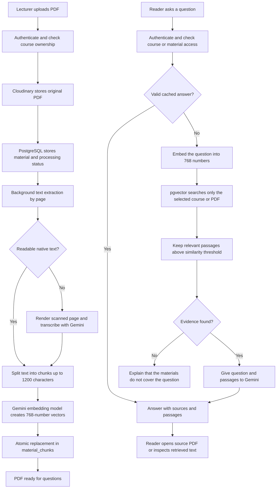

# AskAnon Course Vault AI - implementation and walkthrough

Verified on 7 November 2026. This describes the code and database in this workspace, not a proposed architecture.

## What the user does

1. Open a course vault. A lecturer uploads lecture slides or notes as a PDF.
2. Wait for the PDF to say **Ready for AI search**. Processing happens separately from the upload response.
3. In **Ask your PDFs**, select one PDF or all ready PDFs in that course.
4. Enter a question and press **Ask question**. Example: "How does paging differ from segmentation?"
5. Read the answer, open its source PDF at the cited page, or expand **View retrieved passages** to inspect the exact text supplied to the model.

The Study task dropdown stays removed. The course companion now supports a short conversation: the last three successful exchanges help resolve follow-ups such as "explain that more simply". Changing the selected PDFs or starting a new conversation clears that context. Up to eight exchanges are displayed in the current page; they are not stored as a separate conversation record in PostgreSQL. Reloading the page clears the conversation.

## Is this just an LLM call?

No. There are two separate pipelines: preparing documents, and retrieving evidence to answer a question. The final explanation is an LLM call, but extraction, chunk storage, vector search, authorization, citations, caching and failure handling happen around it. That complete pattern is retrieval-augmented generation (RAG). We do not train or fine-tune a model.



## Document preparation, step by step

- **Storage:** Cloudinary stores the original file. PostgreSQL's `course_materials` stores its ID, course ownership, URL, type, processing status and indexing timestamp.
- **Extraction:** `pdf-parse` reads native text page by page. Pages with fewer than 15 readable characters are candidates for image transcription. Gemini receives the rendered page and a transcription-only instruction. This supports scanned documents; it does not make missing or illegible content reliable.
- **Chunking:** Each page is split into chunks of at most approximately 1,200 characters, breaking at spaces. Each chunk keeps its PDF ID, sequential chunk number and page number. Current chunks do not overlap.
- **Embedding:** `gemini-embedding-001` converts each chunk into 768 numbers representing semantic relationships. Requests run in groups of three. These vectors enable matching related wording rather than only identical keywords.
- **Persistence:** Prisma creates the chunk records. A narrowly isolated parameterized SQL operation writes the vector field because Prisma represents pgvector as an Unsupported field. Ordinary CRUD remains Prisma-based.
- **Atomic replacement:** The old index is replaced only after extraction and every embedding succeed. A failed reindex retains the earlier complete index. The original PDF is not deleted.
- **Bounds:** 25 MB file limit, at most 250 chunks, at most 12 scanned pages and a 120-second document processing deadline. A scanned page has its own bounded transcription request. Interrupted work becomes retryable after a backend restart.

## Answering a question, step by step

1. Clerk verifies identity. The server checks course ownership/enrollment or material access before retrieval.
2. The server finds indexed PDFs in the requested scope. Selecting one PDF restricts retrieval to that PDF; course search restricts it to the accessible course.
3. A successful-answer cache is checked. Its key includes the question, bounded conversation history, task, scope, generation model configuration and document/index versions.
4. On a cache miss, the question is embedded using the same 768-dimensional embedding model. A bounded amount of the recent questions and last explanation is included in the retrieval query to resolve follow-ups; previous AI answers are context, not factual evidence.
5. PostgreSQL computes cosine distance using pgvector's `<=>` operator. Similarity is `1 - distance`.
6. Single-PDF search retrieves up to 8 seed chunks; course-wide search retrieves up to 12. Results below the current 0.45 similarity threshold are discarded. Immediate neighboring chunks are added through scoped Prisma reads to preserve definitions and explanations together, with at most 14 total passages for a PDF or 18 for a course. This is a heuristic, not a validated confidence score.
7. If no passages survive, the server returns an explicit insufficient-material response and skips text generation.
8. Otherwise the prompt includes the question, retrieved text, PDF titles and page references. Gemini is instructed to use those excerpts, cite sources and admit when the evidence is insufficient.
9. The response contains the answer, source list, exact retrieved passages, up to three grounded follow-up questions, and optional practice questions. The UI shows Markdown (including responsive comparison tables), clickable PDF/page sources and expandable evidence. Practice solutions stay hidden until Show worked answer is selected. A source link opens the original PDF; the page fragment depends on the browser PDF viewer.
10. Successful results are cached for one hour. Errors are not cached as successful answers. Query/document embeddings and successful scanned-page transcriptions have 24-hour caches; Redis has an in-memory fallback.

**Overview exception:** A broad request such as "What are the topics covered?" uses bounded first/middle/last chunk sampling from up to 12 PDFs, rather than pretending a semantic top-6 search summarizes every page. The UI labels this coverage. The backend retains older overview/revision/practice modes for compatibility, but the new interface has no task selector.

## Where is the index? Is it IndexedDB?

It is **PostgreSQL with pgvector on the configured Supabase database**. It is not browser IndexedDB, and there is no separate Pinecone/Chroma database.

The live database inspection confirmed pgvector **0.8.0** and 768-dimensional vectors. The `material_chunks` table contains:

| Column | Purpose |
| --- | --- |
| `id` | Chunk identifier |
| `material_id` | The original PDF record |
| `chunk_text` | Extracted text supplied as evidence |
| `chunk_index` | Ordering within the PDF |
| `page_number` | Page used by the citation |
| `embedding` | A `vector(768)` for similarity search |
| `created_at` | Storage timestamp |

There is a primary-key index and a B-tree index on `material_id`. There is **no HNSW or IVFFlat approximate vector index** at present. Search is exact nearest-neighbor search over the scoped stored vectors. This is reasonable for the small current collection; an approximate index and retrieval benchmarks become relevant as it grows. Do not claim we built HNSW or a large-scale vector-search system.

The two PDFs shown in the reported failure were reindexed: the resume contains 3 chunks with page references; operating basics contains 12. Older legacy PDFs elsewhere may still need reindexing for page references.

## How to see it yourself

**In the website:** Ask a PDF question, then expand **View retrieved passages**. These are actual stored excerpts, not a second generated summary. Open a source card to compare against the PDF page.

**From the terminal:** Run from `backend`:

```powershell
node scripts/inspectRagIndex.mjs
node scripts/inspectRagIndex.mjs --material 4
node scripts/inspectRagIndex.mjs --material 4 --show-text
```

The first command reports the extension, database indexes, material statuses, chunk counts and vector dimensions. The second reports a chosen PDF's chunk order, page and character counts. The third explicitly includes that PDF's text. These are read-only commands; they do not upload, reindex, delete, or call Gemini. Default output omits document text and credentials.

You can also open Supabase's Table Editor and inspect `course_materials` and `material_chunks`. Vector values are numeric representations; the useful evidence to inspect is `chunk_text` alongside `material_id` and `page_number`.

## Why the reported AI error happened, and what changed

The original generation request returned HTTP 503 `UNAVAILABLE`: Gemini reported that the configured model was experiencing high demand. The stored vectors were present. Reindexing alone would not fix provider overload.

Vault generation and scanned-page transcription now allow one fallback after transient provider 500/502/503/504 failures, within one overall request deadline. The primary remains `GEMINI_MODEL`; the fallback is `GEMINI_RAG_FALLBACK_MODEL`, defaulting to `gemini-3.5-flash-lite`. The provider's model listing advertised an older 2.5 model that its generation endpoint rejected as retired; the implemented fallback was verified with an actual successful answer. No billing or API-key configuration was changed.

Quota/429 errors, invalid requests, incomplete responses and safety-blocked output do not cause a hidden retry loop. If both generation attempts fail after retrieval, the UI shows an error and a Retry button, but still exposes the retrieved passages so the reader can inspect the source. It never presents those passages as a successfully generated answer.

A temporary provider outage can still affect AI. Caching and fallback improve resilience; they cannot guarantee availability. The final AI answer can also contain mistakes even with citations, so the original source remains visible.

## What the other AI features do

- **Duplicate doubts:** Question embeddings and cosine similarity suggest an existing active question. Exact normalized matches are checked first. This is semantic matching, not a generated answer and not the PDF RAG pipeline.
- **Question moderation:** Local text filters plus Gemini classification assess abuse/relevance against lecture context. Rejected text is not published; unavailable checking asks the student to retry. Classroom image attachments are not automatically moderated.
- **Lecture recap:** Gemini synthesizes recorded questions, written answers and poll results. This is a structured LLM synthesis over supplied classroom records, not vector retrieval from course PDFs.

## Honest interview explanation

"I implemented a course-scoped RAG assistant. Uploaded PDFs are extracted page by page, chunked and embedded into 768-dimensional vectors stored in PostgreSQL with pgvector. A question retrieves relevant authorized passages using cosine similarity, and Gemini generates an answer with source-page references. Users can inspect the actual retrieved text. I also added indexing state, atomic reindexing, caching and bounded recovery from provider overload."

Be ready to explain the trade-offs: exact search at this scale, no chunk overlap or reranker, short page-local conversation context rather than durable chat history, sampled broad overviews, probabilistic relevance thresholds, scanned-document limits and provider dependence. Those are stronger engineering talking points than claiming the assistant can answer everything.

## Code map

- `backend/src/utils/ragService.js`: extraction orchestration, chunking, embeddings, vector retrieval, evidence prompts and caching.
- `backend/src/utils/pdfTextService.js`: scanned-page transcription.
- `backend/src/utils/geminiClient.js`: bounded provider requests, explicit errors and overload fallback.
- `backend/src/middleware/accessMiddleware.js`: course/material authorization.
- `backend/prisma/schema.prisma`: material/chunk models and vector field.
- `backend/scripts/inspectRagIndex.mjs`: read-only database inspection.
- `frontend/src/components/course/VaultAssistant.jsx`: question form, answers, PDF links and evidence viewer.


## Companion depth and practice update

The generation prompt now adapts to the question: factual lookups can be short, substantive concept explanations target roughly 300-600 words, and explicit detailed requests may reach 600-1000 words when the evidence supports that. These are guidance, not guaranteed word counts; thin material must not be padded. The output allowance is 6000 tokens, within a 40-second generation deadline that also bounds the overload fallback.

A structured JSON response separates the explanation, follow-up suggestions and practice answers. The client keeps practice answers behind reveal controls. Previous answers are explicitly marked non-authoritative in the prompt. History accepts at most three question/answer pairs (2000/6000 characters respectively); invalid or oversized context is rejected. The context is cleared on PDF/course changes. Follow-up suggestions use the existing authorized endpoint, with no extra generation call just to create suggestions.

Observed acceptance examples: a detailed IoT question produced a 383-word answer with 11 retrieved passages; a simpler follow-up retained the topic and produced 191 words; Check my understanding returned three practice questions with initially collapsed answers. These examples demonstrate behavior, not retrieval accuracy benchmarks or guaranteed lengths.
