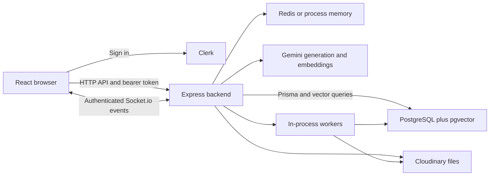

# Project and architecture

## What are we building?

**AskAnon — Same Classroom. More Questions.** It is a classroom question feed with a course-material study companion. A student who would hesitate to interrupt a lecture can ask a question without displaying a name. Classmates vote on useful doubts; the teacher answers and shares material. After class, students revisit the discussion and ask questions grounded in course PDFs.

It is not a university administration system. There are no departments, institutional approval chains, attendance registers or university-managed accounts. A Teacher is a self-selected hosting role, not verified employment status.

Courses provide continuity between lectures. A session is one classroom discussion; a course groups sessions, resources and enrollments. Without courses, each lecture's material would be isolated and students would repeatedly search for it.

## The complete journey

1. A visitor chooses Sign In or Get Started. Both authenticate first through Clerk.
2. A new identity chooses Student or Teacher once; a returning identity keeps its saved role.
3. A teacher creates a session, optionally choosing an owned course, and shares a six-character code.
4. A signed-in student enters the code. Joining a live course-linked session establishes enrollment in that course.
5. The student asks, votes and participates in polls. The teacher pins, answers, dismisses, pauses intake and broadcasts notes, code or images.
6. A teacher can upload PDFs or save classroom diagrams into the vault. A standalone lecture gets linked to the teacher's general vault when a resource needs a course.
7. Ending the lecture closes live participation; the recap exposes recorded discussion and AI synthesis when available.
8. Students return to enrolled vaults, saved questions and concluded course lectures. Vault AI retrieves relevant PDF excerpts and explains them with sources.

## High-level design

**HTTP** handles resource reads and most writes. A request has a response that confirms a result. **Socket.io** pushes updates to the appropriate connected classroom and workspace. Poll actions and pause/resume also enter through socket events. This is a mixed design, not an application where every operation is a WebSocket message.

## What each technology does

| Technology | Its actual job |
|---|---|
| React 19 | Pages, components, UI state, effects and event handling |
| Vite | Development server and frontend production bundling |
| Custom CSS | Shared tokens and scoped page/component styling; no Tailwind requirement |
| Clerk | Login identities, session tokens and verified profile information |
| Node.js / Express 5 | Backend runtime, routes, middleware and HTTP responses |
| Socket.io | Authenticated rooms, server broadcasts, acknowledgements and reconnection support |
| Prisma 6 | Most relational CRUD, transactions and schema mapping |
| PostgreSQL / Supabase | Durable users, courses, sessions, votes, jobs and material records |
| pgvector | Stores document vectors and provides cosine-distance operators inside PostgreSQL |
| Redis | Shared cache entries and counters; bounded process-memory fallback exists |
| Cloudinary | Original material files and classroom images; database stores references |
| Gemini | Text classification, grounded generation, scanned-page transcription and embedding API |

## What the AI actually adds

There are several independent operations:

- **Moderation:** classify written submissions using lecture context. It is not RAG.
- **Duplicate suggestions:** compare a question with cached embeddings of active questions.
- **PDF ingestion:** extract text, optionally transcribe scanned pages, then store searchable chunks and vectors.
- **Vault RAG:** retrieve course/material passages before asking Gemini to write an answer.
- **Recaps:** synthesize recorded discussion and polls. This uses selected records, not PDF vector retrieval.

## Boundaries worth saying honestly

- Questions have no author relation in the current `Question` model. Accounts, enrollments and votes do have identity associations. Do not promise either universal anonymity or the ability to identify every question's author.
- AI output is not guaranteed correct. Sources allow checking; they are not automatic proof that every generated claim is supported.
- Classroom image attachments are not automatically image-moderated. Scanned PDF transcription is a separate pipeline.
- The system is designed around one backend instance. Redis alone does not make socket rooms or in-memory grants distributed.
- Long PDFs, slow providers and free hosting affect availability. No measured large-class capacity or uptime guarantee is claimed.
- Cloudinary delivery URLs are not a private-document security system. Use public-safe demonstration material.

## Deployment picture

The demo topology is a static Vercel frontend, a persistent Render backend and the existing external services. Public hosting configuration can change independently of GitHub code. Development Clerk authentication on a hosted demo should not be presented as fully configured production authentication.

## Project pitch

**30 seconds:** “AskAnon lets students ask questions during lectures without showing their names. Teachers manage a live question feed, polls and shared materials. After class, students revisit course PDFs through a RAG companion that retrieves relevant excerpts and generates source-linked explanations.”

For a two-minute explanation, add one live-question flow, one PDF retrieval flow and one honest limitation. Use the architecture diagram as your structure, not a list of every feature.

Evidence: [frontend routes](../../frontend/src/App.jsx), [backend startup](../../backend/src/app.js), [schema](../../backend/prisma/schema.prisma), [access rules](../../backend/src/middleware/accessMiddleware.js).
