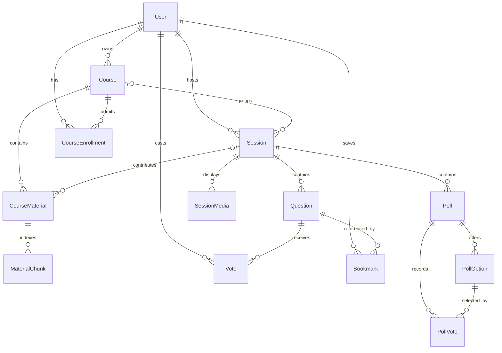

# Code and database map

## The important folders

```text
frontend/src/
  main.jsx              React root and Clerk provider
  App.jsx               Browser routes and protected pages
  pages/                Page state and user workflows
  components/           Dashboard, classroom, vault and shared UI
  hooks/                Pending actions, workspace refresh and accessibility
  utils/                Resource cache, downloads, network tracking, exports
  styles/               Shared design tokens
backend/src/
  app.js                Express, HTTP server, sockets and workers
  config/               Prisma, Redis, Cloudinary and allowed origins
  routes/               HTTP methods, paths and middleware wiring
  middleware/           Identity, permissions and request budgets
  controllers/          HTTP workflow orchestration
  socket/               Socket.io commands and room membership
  utils/                AI, cache, polls, lifecycle and storage logic
backend/prisma/         Schema, baseline and migration SQL
backend/test/           Isolated backend regression tests
backend/scripts/        Opt-in database/integration/inspection tools
scripts/check.mjs       Local release-check entry point
```

The backend's `utils` directory contains substantial service logic, not just tiny formatting helpers. Do not look for a nonexistent `services/aiInsightsService.js`; the current implementation is under `utils/`.

## Frontend startup and routes

[main.jsx](../../frontend/src/main.jsx) creates the React root, loads global CSS and wraps the application in ClerkProvider. Its configured authentication redirects lead to the dashboard. [App.jsx](../../frontend/src/App.jsx) mounts BrowserRouter, an error boundary and lazy-loaded protected pages. The landing page is imported directly, so it does not require fetching dashboard data first.

| URL | Main page | Responsibility |
|---|---|---|
| `/` | LandingPage | Public product information and authentication entry |
| `/onboarding` | Onboarding | Authenticate if unsigned; choose a role if new |
| `/dashboard` | Dashboard | Role-specific workspace, course/session navigation and creation |
| `/join` | JoinSession | Join using a lecture code |
| `/session/:code` | SessionRoom | Live lecture data, listeners and actions |
| `/session/:code/recap` | SessionRecap | Recorded questions, polls, materials and insights |
| `/courses/:id` | CourseDetail | Course material and lecture views, vault companion |

[Dashboard.jsx](../../frontend/src/pages/Dashboard.jsx) owns data/state and handlers; `components/dashboard/` renders faculty tabs and modals. SessionRoom similarly composes QuestionCard, QuestionInput, MaterialsDrawer, MediaStrip and other classroom components. A component can receive a handler rather than make its own independent request.

[usePendingActions](../../frontend/src/hooks/usePendingActions.js) tracks action-specific busy states. [useWorkspaceUpdates](../../frontend/src/hooks/useWorkspaceUpdates.js) refreshes pages on private workspace events. [resourceCache.mjs](../../frontend/src/utils/resourceCache.mjs) avoids unnecessary repeated frontend reads. Do not confuse it with Redis or vector storage. The repository's `useSession.js` and `SocketContext.jsx` are currently empty placeholders; the actual room socket lifecycle is in SessionRoom, not those filenames.

## Backend request path

[app.js](../../backend/src/app.js) creates Express, wraps it in an HTTP server, attaches Socket.io, configures CORS/body limits, mounts routes and starts recovery workers. Ordinary flow:

```text
HTTP request
  → route matches method/path
  → identity and access middleware
  → controller validates and coordinates work
  → Prisma / supporting service
  → committed data, invalidation and notification
  → HTTP response
```

[authMiddleware.js](../../backend/src/middleware/authMiddleware.js) verifies the bearer token with Clerk and resolves the application user. [accessMiddleware.js](../../backend/src/middleware/accessMiddleware.js) checks ownership, course enrollment and lecture access. Controllers are not replaced by middleware: critical write checks also occur inside transactions to protect against changes between an earlier read and the write.

## Database relationships

The authoritative definition is [schema.prisma](../../backend/prisma/schema.prisma). This diagram shows the core relationships; maintenance job tables are described below.



| Model | Meaning and details to remember |
|---|---|
| User | Application profile; unique Clerk ID and email, saved role. Clerk account itself is external. |
| Course | Teacher-owned resource grouping; unique course code. |
| Session | Teacher-owned lecture, unique six-character code, optional course, active/paused state and recap JSON. |
| Question | Text, optional image/code, status and written answer. No submitting-user field. |
| Vote | Links a user to a question; unique `(question_id, user_id)`. |
| Bookmark | Links a user to a saved question; unique pair prevents duplicate saves. |
| CourseEnrollment | Links a user to a course; unique pair supports idempotent enrollment. |
| CourseMaterial | Cloudinary reference, type, optional originating session and index status. |
| MaterialChunk | Text, page, sequence position, material ID and nullable `vector(768)` embedding. |
| SessionMedia | A classroom image reference and caption; can share an asset with vault material. |
| Poll / PollOption | Question/options with active/visible states and stored option counts. |
| PollVote | Poll/option, optional numeric user ID and unique `(poll_id, voter_key)`; user ID is not a declared User relation here. |

Two maintenance models matter. `StorageCleanup` records pending external-file deletion with a composite asset/type key. `SessionDeletionJob` stores an owner's requested lecture cleanup, status, retry time, attempts and lease token. A lease is a temporary claim on a job, allowing abandoned work to be reclaimed.

### Constraints versus application checks

Roles, question states and indexing states are represented as strings, not Prisma enums. Controllers validate accepted values, but the schema alone does not enforce every possible transition. Question `related_to_id` is an integer, not a declared self-relation; cleanup explicitly clears references. Keep those limitations separate from the constraints that really exist.

### Indexes and transactions

The checked-in schema/SQL has no HNSW or IVFFlat vector index definition. `MaterialChunk.material_id` has an ordinary index, which is different. Actual database-only changes require catalog inspection; do not infer their absence from repository files alone.

A transaction groups writes so either they all commit or they roll back. [classroomTransaction](../../backend/src/utils/transaction.js) uses Serializable isolation and retries Prisma `P2034` conflicts up to three attempts. Serializable aims for results consistent with transactions running one at a time; retry is still necessary. It is not a way to make network latency disappear.

## Where would I change this?

| Change | Start here |
|---|---|
| New frontend URL | `frontend/src/App.jsx` and its page |
| Role choice or returning-account issue | Onboarding, Dashboard, `routes/userRoutes.js` |
| Question validation/moderation | `questionController.js`, `contentModerator.js` |
| Real-time control | `socket/socketHandler.js`, SessionRoom listeners |
| Course visibility | `accessMiddleware.js`, course controller |
| PDF retrieval or answer depth | `ragService.js` and VaultAssistant |
| Deletion/recovery | `sessionDeletionJobs.js`, `sessionLifecycle.js`, `storageLifecycle.js` |
| Slow repeated reads | Cache helper, response bundle and relevant indexes |