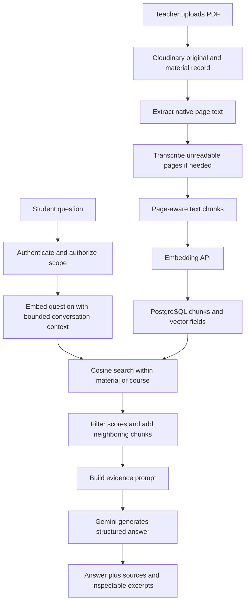

# AI and RAG, explained from the beginning

## 1. The problem before the terminology

A teacher uploads Operating Systems notes. A student asks, “According to these notes, how is a thread different from a process?” Gemini does not automatically see a PDF just because it exists in Cloudinary. A direct question can produce a reasonable general answer, but it might not match that teacher's material.

AskAnon first finds useful passages from the authorized PDFs, then includes those passages with the question. Gemini explains that evidence. This is **retrieval-augmented generation**, or RAG:

- **Retrieval:** find relevant stored text.
- **Augmentation:** add it to the model's input as context.
- **Generation:** let the model compose an answer from that context.

Remember: **search finds evidence; generation explains it**. Neither step trains a new model.

## 2. Minimum AI foundations

**AI** is the broad field of systems performing tasks associated with intelligence. **Machine learning** learns patterns from data. **Generative AI** produces new content using learned patterns. An **LLM**, or large language model, predicts tokens conditioned on its input and previous output; it does not perform a guaranteed factual database lookup each time it writes.

Gemini is the model/provider family used through Google's hosted APIs. AskAnon builds prompts and HTTP requests; it does not implement the model's neural network. A prompt is the instruction plus task data sent to the model. Role/system instructions are a general prompting concept; this application's text helper currently sends instructions and evidence in a `contents` text part, not a separate `systemInstruction` field.

A **token** is a model-specific unit of text, often part of a word. A **context window** limits input/output that a model can consider. Character counts are not token counts. A 1,200-character chunk is not a 1,200-token chunk. Output limits bound possible response length, but do not guarantee an answer of that length or quality.

A **generation model** returns an explanation or classification. An **embedding model** returns a list of numbers representing text for similarity comparisons. The vector is not a human-readable answer, encrypted text or a reliable compressed copy of the document. Similar topics tend to have similar vector directions, but similarity is imperfect and depends on the model.

A **hallucination** is plausible output unsupported by evidence or reality. **Grounding** asks the model to base claims on supplied evidence. RAG can reduce unsupported answers, but retrieval errors, misleading documents and generation mistakes remain possible.

**Fine-tuning** changes a model's parameters using training examples. RAG keeps external knowledge outside the model and retrieves it at request time. AskAnon uses RAG, not fine-tuning. New PDFs require indexing, not retraining Gemini.

## 3. Two separate pipelines

Ingestion runs when a PDF is uploaded/reindexed. Querying normally reuses its stored chunks and vectors; it does not download and embed the entire PDF on every question. Overview/revision requests use a separate sampling path explained below.

## 4. Stage A: make a PDF searchable

### Upload and ownership

[uploadMaterial](../../backend/src/controllers/materialController.js) stores metadata after authorized Cloudinary upload. `CourseMaterial` records the course, optional lecture, URL, asset ID, type and indexing state. The upload response can succeed while indexing is pending. That distinction avoids keeping an upload request open for the full AI pipeline.

### Extraction and scanned pages

[processAndEmbedMaterial](../../backend/src/utils/ragService.js) fetches the stored PDF with a bounded request and 25 MB read limit. `pdf-parse` extracts text page by page. Native text is preferred because it avoids a transcription API call and preserves page association.

Pages with fewer than 15 trimmed characters enter [recoverScannedPages](../../backend/src/utils/pdfTextService.js). It renders a page image and asks Gemini to transcribe visible text rather than summarize or follow printed instructions. Limits include at most 12 unreadable pages, 1,600-pixel requested screenshot width and a 6 MB prepared page-image limit. Unclear symbols and handwriting can still be transcribed incorrectly. A diagram without useful text does not become semantically understood simply because it was rendered.

### Chunking

`chunkText` collapses whitespace and splits each page into passages of up to about **1,200 characters**, preferring a preceding space near the boundary. Text shorter than 15 trimmed characters is excluded. Chunks retain page number and a sequence index.

Why split? Sending an entire long PDF per request adds cost, latency and irrelevant input. Retrieval needs addressable passages. Smaller passages can match specific questions; larger passages preserve explanation. The current size is an implementation parameter, not a value proven optimal by a benchmark.

There is **no explicit overlapping text between chunks** in this function. Neighbor expansion later retrieves adjacent chunks to recover context. This is not identical to overlap: overlap repeats boundary text during indexing; expansion adds stored passages after retrieval.

### Embeddings and storage

`generateEmbedding` calls `gemini-embedding-001:embedContent`, requests **768 dimensions**, and validates finite numeric values and the exact array length. Chunks are embedded in batches of three. This is bounded concurrency, not a batch-embedding endpoint. Cached embeddings use a content hash with a 24-hour TTL.

Vectors and chunk text live in **PostgreSQL**, in `MaterialChunk.embedding` as `vector(768)`. Cloudinary holds originals; Redis caches results; IndexedDB is not the vector database. pgvector supplies the vector type and distance operator, so a separate Pinecone-like service is unnecessary for this project.

### Atomic replacement and job state

Only after all replacement embeddings succeed does a transaction remove old chunks, create new ones, write vectors and mark the material ready. Partial vector creation must not replace a previously complete index. A failed attempt preserves old stored chunks where available; status can report the retry failure while old content remains searchable.

The process shares a Promise for repeated indexing of the same material and allows at most two indexing jobs. A job rejects over 250 chunks and has a 120-second provider-work deadline. This signal does not guarantee every CPU parsing operation is forcibly interrupted. There is no cross-material content-deduplication guarantee or durable distributed index queue. On backend startup, interrupted indexing/ocr states are marked failed for retry.

## 5. Stage B: answer a question

### Authorize before retrieval

Course/material routes check the signed-in user's ownership or enrollment before calling RAG. The retrieval query also restricts material/course IDs. A course ID supplied by a client is not trusted as proof of access. These protections must remain before cache/retrieval use; a prompt telling Gemini “do not reveal other courses” would not be an adequate security control.

### Query embedding and short history

The request accepts at most three bounded prior turns. `vaultSearchQuery` adds recent topics and a shortened previous answer to resolve follow-ups. History is request-carried context, not persistent chat memory or factual evidence.

This is short request-carried conversation context, not a persistent conversational memory database. There is no evidence here of durable per-user chat history or model training from conversations.

### Similarity search

**Cosine similarity** compares vector direction: `dot(A,B) / (length(A) × length(B))`. It is not a percentage probability of correctness. pgvector's `<=>` operator computes cosine distance; AskAnon selects `1 - distance` as similarity and orders by distance.

The active `askVault` path retrieves **8 seeds for one material or 12 for a course**, filters scores below **0.45**, and expands neighbors to at most **14 or 18 chunks** respectively. Search helper default arguments are 4/6, but the caller overrides them; documenting only the defaults would misdescribe the UI path.

The threshold reduces weak matches but is not validated as an ideal universal boundary. A relevant explanation might score below it; an irrelevant passage might score above it. Empty retained context returns an insufficient-evidence message without a generation call.

A **retriever** is the logic selecting evidence. A **top-K** request asks for a bounded number of closest passages. **Metadata filtering** restricts scope using fields such as material/course ID. Neighbor expansion keeps nearby explanation with a matching definition and removes duplicate chunk IDs; it is not semantic reranking.

### Prompt and response

`answerFromChunks` numbers the actual materials and constructs excerpt blocks with material titles and page numbers. It instructs Gemini to use only those excerpts for factual claims, admit missing support, and treat documents/history as untrusted data rather than instructions.

The request uses JSON output with `answer`, `followUps` and `practice`. The server validates shape, bounds follow-ups/practice to three and returns separate `sources` and `evidence` assembled from retrieved records. Substantive explanations are prompted toward 300–600 words, or 600–1,000 when detail is requested, only where evidence supports it; a factual lookup may remain brief. Output is capped at 6,000 tokens and a 40-second generation deadline.

The frontend links sources to material/page URLs and exposes retrieved passages. Inline citations are generated by the model, not independently verified claim by claim. A source panel proves what was retrieved, not that every sentence is supported.

If generation fails after retrieval, error metadata carries evidence/sources so excerpts can still be inspected rather than inventing an answer. A provider response is accepted only when it finishes completely and contains usable text; malformed JSON or incomplete structures are errors.

## 6. Overview and revision are sampled, not exhaustive

The backend recognizes overview/revision modes and summary-like question wording. Instead of semantic top-K retrieval, it selects first/middle/last chunks from up to 12 indexed PDFs, capped at 36 records. It returns coverage metadata including whether selection was sampled.

This gives broader document coverage than a few query-nearest chunks, but does **not** read every page or guarantee every topic appears. The request can be routed to sampling even when mode is `ask` if the wording looks like a summary. Practice mode uses excerpts to generate exercises with separate revealable answers; they are generated study questions, not actual exam predictions.

## 7. Other AI features, separately

| Feature | Input and mechanism | Storage / failure policy |
|---|---|---|
| Contextual moderation | Written submission + lecture title/subject → local rules and Gemini JSON classification | Safe results/rejections cached by text and context; unavailable checking blocks written publication |
| Duplicate suggestion | Normalized exact match, then question embeddings and cosine comparison | Up to 25 active text-only candidates; compares already-cached candidate vectors; failure skips suggestion |
| Scanned transcription | Rendered unreadable PDF page → Gemini vision text | Cached by image/model hash; bounded and retryable; not an abuse classifier |
| PDF RAG | Question + retrieved stored passages → generated explanation | Persistent chunk vectors; cached answers and inspectable evidence |
| Lecture recap | Selected discussion, written answers, code and polls → structured synthesis | Stored session summary; shared pending generation; no PDF vector retrieval |

Duplicate detection uses the same embedding helper/model, but not `MaterialChunk` nearest-neighbor queries. It normalizes case/spacing/trailing punctuation for exact matches. For semantics it embeds the new question and reads cached candidate vectors. Accepted questions warm vectors asynchronously; after caches are lost, older candidates may be skipped. It does not automatically embed every candidate during the check.

`DUPLICATE_THRESHOLD` overrides a **0.82 code default**. This is different from the **0.45 document retrieval filter**. Do not apply one threshold to the other feature. A duplicate pre-check may prewarm moderation, but prewarming is not final publication permission.

Recaps select up to 40 high-voted visible discussion records and 15 polls, excluding flagged/dismissed questions. The prompt says that votes indicate interest, not mastery, and unanswered questions do not prove misconceptions. Image presence can be recorded without interpreting its contents. Recaps currently call the direct generation helper; do not promise every AI call has the same model fallback.

## 8. Failure, cost and trust

| Situation | Actual response / important limit |
|---|---|
| Primary moderation overload | One fallback; primary attempt bounded to 4 seconds within 10 seconds total; optional moderation fallback override |
| Primary moderation timeout | Same one-fallback policy if overall time remains |
| Vault/transcription provider 5xx | One generation fallback within the caller's total deadline |
| Quota exhausted / 429 | No hidden model-hopping retry; retry metadata and error returned |
| Embedding unavailable | Duplicate hint may be skipped; PDF indexing/search cannot pretend vectors exist |
| Incomplete generated text / bad JSON | Reject output rather than show partial output as a successful complete answer |
| No searchable PDF | Conflict/retry guidance; ordinary images remain available |
| No relevant chunks | Insufficient-evidence response; no fabricated answer |
| Reindex failure | Old complete chunks retained until successful replacement |

Current code generation default is `gemini-3.1-flash-lite`; generation/moderation fallback defaults use `gemini-3.5-flash-lite`. Model IDs are configuration/code facts, **not a current availability endorsement**. No live provider test was run for this handbook. Model access, regional availability and quota must be checked in the actual account. The fallback is the same provider, not independent failover, and embeddings do not use this generation fallback.

Prompt injection means malicious document text tries to override instructions. The prompt explicitly treats excerpts as data, and authorization limits the scope; this reduces risk but is not a formal prompt-injection defense or factual verifier. Private-resource access must be enforced outside the model.

## 9. Implemented here versus general concepts

| Capability | AskAnon status from source |
|---|---|
| Native extraction, bounded scanned transcription, chunks, embeddings | Implemented; real provider/document quality still needs live checking |
| Persistent vectors, scoped cosine retrieval, neighbors, evidence | Implemented |
| Overlapping chunk text | Not implemented; adjacent retrieval is a different approach |
| HNSW/IVFFlat approximate vector index | No checked-in definition; inspect live catalogs before claiming one |
| Hybrid keyword + vector retrieval | Not implemented; exact question matching is a separate feature |
| Semantic reranker | Not implemented; no second model scores passage relevance |
| LangChain/LlamaIndex orchestration | Not used; ordinary functions connect the bounded pipeline |
| Fine-tuning / self-trained model | Not implemented or needed for current document lookup |
| Automatic claim-by-claim citation verification | Not implemented |
| Formal retrieval-quality benchmark | Not established by the existing tests |

## 10. How to evaluate and improve it simply

Prepare a small set of real course questions: direct lookup, paraphrase, comparison, follow-up and an unsupported topic. Write expected evidence pages before asking the assistant. Check retrieval first: are the needed passages present? Then check generation: is the answer supported, correctly cited and appropriately uncertain?

Measure retrieval hit/recall at K, unsupported claims, citation usefulness, latency and provider failure rate separately. A fluent answer can hide bad retrieval. Mocked tests verify plumbing and edge cases, not semantic quality. This evaluation set is a recommendation, not an existing benchmark result.

Source trail: [RAG pipeline](../../backend/src/utils/ragService.js), [PDF transcription](../../backend/src/utils/pdfTextService.js), [generation and fallback](../../backend/src/utils/geminiClient.js), [moderation](../../backend/src/utils/contentModerator.js), [question similarity](../../backend/src/utils/embeddingService.js), [recaps](../../backend/src/utils/aiInsightsService.js), [AI regression tests](../../backend/test/ai.test.js).
