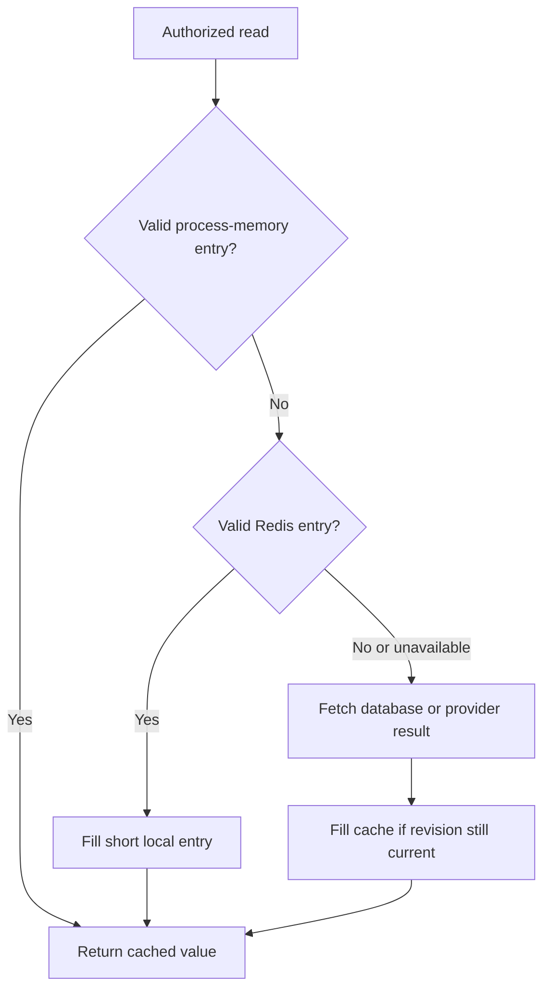

# System design in practice: defend the implementation

This chapter explains engineering decisions through AskAnon, not an imaginary system with millions of users. Read it after the [architecture](01-PROJECT-AND-ARCHITECTURE.md) and [feature flows](03-HOW-FEATURES-WORK.md).

Each section covers the problem, current implementation, benefit, limitation and a likely interview follow-up. Benefits describe mechanisms, **not measured percentage improvements**. Code inspection establishes the implementation; production capacity, query plans and before/after speedups need separate measurement.

## 1. Begin with requirements, not infrastructure

**Interviewer:** “Design a classroom question platform. Where do you start?”

Start with the users and actions: a teacher hosts a lecture; students join, ask and vote; classmates see updates; material remains accessible afterward. Essential correctness rules are ownership, one vote per user/question, course isolation and no unchecked written question publication when moderation fails.

Separate **functional requirements** (what users do) from **quality requirements** (latency, correctness, recovery and availability). AskAnon aims for responsive classroom interaction, but no formal latency or availability target has been established. Do not turn an aspiration such as “instant” into a measured service guarantee.

The current design uses a browser, one backend, PostgreSQL and a few managed dependencies. A single backend application with separate external services is not a microservices architecture. Redis, a CDN or a queue should solve an identified problem rather than be added to make an architecture diagram look sophisticated.

**Say:** “I would first define the classroom workflows and consistency rules, then choose the simplest architecture that meets them. This version uses one backend and durable database state; its scaling limits are explicit.”

## 2. Which indexes exist, and why do they help?

**Problem:** A live feed repeatedly filters questions by session and orders them by votes and creation time. Scanning and sorting every question becomes expensive as data grows.

The [Prisma schema](../../backend/prisma/schema.prisma) declares a composite index:

```prisma
@@index([session_id, upvotes(sort: Desc), created_at(sort: Asc)])
```

The [question controller](../../backend/src/controllers/questionController.js) reads a session's questions with the matching vote/time ordering. The index groups entries by session and orders within that group. This can reduce work finding the relevant range and supplying the requested order.

Other examples connect directly to access patterns:

| Index or constraint | Access pattern / purpose |
|---|---|
| Unique session code | Find one lecture from its shared code; also prevent collisions |
| Session teacher/course indexes | Find hosted lectures or lectures belonging to a course |
| Unique enrollment `(user_id, course_id)` | Check access and prevent duplicate enrollment |
| Question vote pair uniqueness | Prevent repeated votes; distinct from feed-order optimization |
| Material course index | List resources in one vault |
| Chunk material index | Find chunks belonging to a PDF |
| Job `(status, available_at)` index | Help locate due cleanup jobs; the full OR predicate/order can still require extra work |

**Why does column order matter?** A B-tree composite index is lexicographically ordered, like a directory sorted by city, surname and first name. It naturally suits filters/orderings starting with its leading columns. The question-feed index is not a universally efficient index for all questions sorted by votes across all sessions. PostgreSQL may still use indexes in other ways; avoid saying non-leading columns can *never* be used.

**Tradeoff:** Indexes consume space and add maintenance on writes. Updating `upvotes` also updates an index containing that value. The planner may choose a sequential scan for a small table or a query returning most rows. Defining an index is not proof it is selected, and a development database may drift from the checked-in schema.

**Say:** “I chose indexes around filters and ordering, not every column. For the question feed, session ID comes first, then vote/time order. I would verify the actual plan rather than claim the index always makes it faster.”

### How would you prove an index helps?

On a suitable test database, inspect a representative read using `EXPLAIN (ANALYZE, BUFFERS)`. It actually executes the query; review the target and query before using it. An illustrative equivalent of the question-list read is:

```sql
EXPLAIN (ANALYZE, BUFFERS)
SELECT * FROM questions
WHERE session_id = 123
ORDER BY upvotes DESC, created_at ASC;
```

Replace the example ID with a test session. Inspect scan type, sorting, rows examined/returned, timing and buffers. Use representative data and repeat warm/cold observations. Do not drop production indexes for a comparison. An index change should be evaluated in a separate test environment.

This is a suggested measurement exercise, not a query executed for this chapter. Ordinary B-tree indexes are also **not** HNSW/IVFFlat vector indexes; see [RAG](04-AI-AND-RAG-EXPLAINED.md).

## 3. Why Redis when PostgreSQL already stores the data?

**Problem:** Many requests ask for the same lecture snapshot, course materials or AI result. Repeating the underlying work adds database/provider load and remote round trips.

[getOrSetCache](../../backend/src/utils/cacheHelper.js) implements cache-aside. The application checks a cached result and only performs the underlying operation on a miss:



For example, a room's question-list key is `cache:room:questions:<sessionId>`. Another participant's read can reuse the list rather than run the same query. Personal votes/bookmarks must be handled with the correct scope, and access must be checked even when a value is cached.

Redis is shared across connections/processes and supports expiring counters. The local Map avoids even a Redis round trip on a local hit. PostgreSQL remains the source of truth; losing cache entries should cause recomputation, not loss of questions.

**What benefit can we claim?** A cache hit avoids the underlying operation. It does not necessarily avoid authentication/authorization queries or all network work. Cached embeddings/answers can avoid provider calls as well as reduce delay. Exact latency improvement depends on hit rate, payload size, serialization and service location. A comment suggesting a millisecond cache hit is not a benchmark.

**Why not only use a Map?** It is simple and works for one process, which is why fallback exists. But it resets on restart and is not shared between replicas. Redis adds a dependency; for a tiny installation the operational cost may outweigh the benefit. The current project keeps a single-backend fallback rather than treating Redis as mandatory durable storage.

**Say:** “Redis saves repeated read/AI work; it doesn't replace PostgreSQL. I would measure cache hit rate and underlying calls avoided, not assume every request became faster.”

## 4. Cache invalidation: why TTL alone is not enough

**Scenario:** A question list is cached. A teacher answers a question. If the entry remains until expiry, another student can briefly see stale state.

After a mutation, controllers invalidate affected keys and broadcast the change. Course responses embed materials/counts, so [invalidateCourseCache](../../backend/src/utils/cacheHelper.js) also clears parent and relevant enrollment/history/manifest keys. **TTL** is the expiration duration; it is a safety bound, not an instant update signal.

There is a subtler race:

1. Read A starts and misses the cache.
2. Write B commits and invalidates the cache.
3. Read A finishes with an older result and tries to cache it again.

The helper captures a process-wide revision. Invalidation increments it. A read whose revision is now old returns its result without refilling the invalidated cache. Reads with the same revision/key can also share a pending Promise, reducing duplicate work during a burst. This is often called request coalescing or single-flight work.

**Limits:** The revision check does not make the original read strongly consistent; an already-running caller can still receive older data. It prevents one refill race in that process. It is not a global version number across multiple servers. Redis invalidation failures and independent local caches can leave stale copies until expiration. Broad revisions can also discard cache fills unrelated to the mutation.

**Say:** “We combine invalidation, expiration and client reconciliation. We also prevent an old in-flight read from repopulating invalidated cache, but that is not a universal consistency guarantee.”

## 5. What does connection pooling solve?

**Problem:** Database connections are finite resources. A backend, scripts and tests can each consume connections. More parallel requests can exhaust a shared pool rather than improve throughput.

[config/prisma.js](../../backend/src/config/prisma.js) creates the application Prisma client and applies `PRISMA_CONNECTION_LIMIT`, defaulting to four. A pool reuses connections instead of opening an independent one for every query. Supabase connection modes and deployment reachability must match the actual configuration; `DIRECT_URL` is a configuration name, not proof that its host bypasses every pooler.

When all connections are busy, additional work waits or fails. Long transactions occupy capacity. Raising the limit can overload PostgreSQL or exceed the provider's connection budget. Two backend instances each with four connections have a different total budget from one instance; include scripts and administration in the calculation.

**Benefit:** Bounded resource usage and less connection churn. **Tradeoff:** Queueing under load. Pooling does not shorten a distant database round trip or fix a slow SQL plan.

**Follow-up:** “Why not run every query in parallel?” Only independent reads should overlap. Dependencies, transaction invariants and available database connections constrain useful concurrency. `Promise.all` overlaps work; it doesn't create unlimited database capacity.

## 6. Concurrent votes and pins: why UI checks are insufficient

Two requests can arrive before React disables a button, or a client can bypass the UI entirely. [usePendingActions](../../frontend/src/hooks/usePendingActions.js) uses a ref to close the pre-render duplicate-click gap, but database correctness must survive independent clients.

For voting, [upvoteQuestion](../../backend/src/controllers/questionController.js) creates a Vote with unique `(question_id, user_id)` and atomically increments the counter inside one transaction. A duplicate insert cannot also commit an extra increment. An atomic increment avoids the lost-update pattern where two readers both write `oldCount + 1`.

[classroomTransaction](../../backend/src/utils/transaction.js) uses Serializable isolation and retries `P2034` conflicts up to three attempts. Pinning resets the old pinned record and pins the selected record within that transaction. The schema does not declare a dedicated partial unique index enforcing one pinned item per session, so do not attribute the invariant to such an index.

**Tradeoff:** Stronger isolation may abort competing transactions. Retry increases work and latency; all conflicts are not magically eliminated. Network uncertainty can still leave a caller unsure whether a commit succeeded.

**Say:** “I use UI guards for feedback, unique constraints for duplicates and transactions for multi-write consistency. Those solve different problems.”

## 7. Persist first, broadcast second—and the remaining failure window

**Problem:** Other students must not see a question as accepted before PostgreSQL commits it. The controller commits the record, invalidates caches and publishes its event. Clients reconcile by record ID when both an HTTP response and an event arrive.

However, PostgreSQL and Socket.io do not share a transaction. The database can commit, then the process can stop before notification. A client might also receive the event while its HTTP response is lost. A later notification/invalidation failure can make a request look failed even though a record exists.

Current recovery is snapshot-based: rejoin and refetch persisted state. There is no durable event-replay log or universal exactly-once delivery guarantee. The deletion worker persists its job, but a crash after marking it complete and before final broadcast still needs reconciliation; it does not create atomic database-plus-socket delivery.

**Possible future approach:** A transactional outbox stores a notification record alongside the domain write, and a worker delivers it later. Consumers still need deduplication because delivery can repeat. AskAnon does not implement a general outbox; it would add complexity beyond this small demo.

**Say:** “Database commit is authoritative. Live events improve responsiveness, while snapshot refresh repairs missed events. I don't claim exactly-once delivery.”

## 8. Retry safety and idempotency

**Idempotency** means repeating a request does not incorrectly repeat its intended effect. It is separate from atomicity: atomicity means related writes all succeed or roll back together.

| Operation | Current repeat behaviour |
|---|---|
| Course enrollment | Unique user/course pair and upsert prevent another enrollment row |
| Question upvote | Duplicate pair rejected; counter does not increment twice |
| Initial role sync | Existing profile/empty upsert update preserves saved role |
| Same material indexing concurrently | Process-local Promise sharing avoids duplicate simultaneous work for that material |
| Deletion worker recovery | Rechecks remaining records and can finish after an interrupted attempt |
| Session/question creation | No general client idempotency-key contract; a lost response followed by retry can duplicate creation |

A duplicate vote returning conflict is not identical to an API returning the same successful response on retry, even though the invariant survives. Same-material job sharing does not deduplicate two uploads of the same PDF under different IDs.

**If needed later:** a client-generated operation key, scoped to identity/action, could be uniquely stored with a result for retry-safe creation. This is a recommendation, not existing functionality. Avoid automatically retrying every mutation simply because HTTP timed out.

## 9. What does “in the background” actually guarantee?

**Indexing:** upload persists a material, responds, then starts processing. A same-material registry and two-job cap bound work. State is stored, but execution is process-local. Startup marks interrupted jobs failed for explicit retry. This is not a durable queue that resumes every index automatically.

**Lecture deletion:** [queueLectureDeletion](../../backend/src/utils/sessionDeletionJobs.js) commits a job and marks sessions unavailable before returning 202. A worker claims due work with a lease/token, prunes transactionally and records completion. Expired claims can be recovered, failed attempts have bounded retries, and shared asset cleanup is separate.

A lease is a temporary right to work on a job, not an eternal lock. Token checks protect completion by the current claimant. Rechecking remaining records makes recovery possible after a partial lifecycle of processing; the database pruning transaction itself should not commit half its deletes.

**Benefit:** The interaction doesn't wait for all downstream work. **Tradeoff:** Users need meaningful pending/failed state. 202 means accepted, not finished. A free host can suspend execution; persisted work waits until a backend runs again. An indexing job cap may produce retryable “busy” state rather than accepting unlimited work.

**Follow-up:** “Why not a separate queue service?” It could improve index durability and worker scaling, but adds cost/operations. The current project deliberately uses different recovery strengths for essential deletion versus retryable indexing.

## 10. Why database and Cloudinary cleanup are separate

Removing a lecture has relational dependencies: votes/bookmarks and poll children must be removed before parents. Saved vault materials are detached, not destroyed. Removing a course detaches sessions but deletes its owned material/chunk/enrollment records. These are product semantics as well as foreign-key concerns.

PostgreSQL cannot roll back a Cloudinary deletion. [storageLifecycle](../../backend/src/utils/storageLifecycle.js) queues cleanup and checks shared references before deleting an asset. A diagram saved to the vault should survive gallery removal because another record still needs the same file.

**Benefit:** Remote failures do not require leaving invalid relational data or deleting shared files prematurely. **Tradeoff:** Files can remain temporarily after their last use, and cleanup needs retries. This is eventual external cleanup, not a distributed transaction.

**Say:** “I commit relational cleanup and durable cleanup intent, then retry external deletion separately. Reference checks protect shared assets.”

## 11. Rate limiting, concurrency and backpressure

**Rate limiting** bounds how many actions are accepted in a window. **Concurrency limiting** bounds simultaneous work. **Backpressure** means refusing or delaying extra work rather than allowing resources to grow without bound.

AskAnon has separate [submission cooldowns](../../backend/src/middleware/authMiddleware.js) and [service budgets](../../backend/src/middleware/serviceLimits.js). AI/recap, upload, manual-index and duplicate-check routes have different windows. Redis counters fall back to bounded local state. Reservations happen before awaiting Redis so overlapping HTTP requests cannot all pass the same local slot.

AI/upload HTTP concurrency is bounded per user and across the process; index execution also has its own cap. An upload allowance does not guarantee immediate indexing capacity. Finishing an HTTP request can release its request slot while background work continues, so the HTTP limit is not a global cap on every ongoing provider operation.

**Tradeoff:** Limits improve resource protection but can reject legitimate bursts. Local fallback restarts/reset and multiple replicas weaken shared guarantees. Provider quota is another independent limit, and one upload may invoke multiple embedding/transcription calls.

**Follow-up:** “Why doesn't this guarantee a zero-cost AI bill?” These controls reduce opportunities for excess use, but don't meter all provider tokens or apply an account-wide hard spending cap. Provider settings and monitoring remain necessary.

## 12. Real-time rooms, reconnects and scaling

[socketHandler](../../backend/src/socket/socketHandler.js) authenticates the handshake, checks commands and joins classroom/private workspace rooms. A room is a notification audience. It is not a durable enrollment table, and membership alone is not permission for an owner action.

On reconnect the client rejoins, receives current pause/poll state and refreshes the HTTP bundle. This repairs state rather than replaying every missed event. Poll votes and pause state live in PostgreSQL, so they survive a socket restart.

**What breaks with a second backend?** A room broadcast in process A does not automatically reach sockets connected to B. Local lecture grants, cached revisions and in-flight work also differ. Database job leases are useful but don't solve every coordination problem.

Future horizontal scaling would require a shared Socket.io adapter/fan-out design, review of grants/caches/jobs and appropriate load-balancer/transport settings. Depending on transport configuration, session affinity may also matter. Redis being installed as a cache does not mean the Socket.io Redis adapter is installed or configured.

**Say:** “This edition runs one backend. Scaling is a deliberate change to state and delivery coordination, not just increasing replicas.”

## 13. Pagination and bounded work

**Problem:** Rendering fewer cards doesn't necessarily mean the backend fetched fewer rows. Progressive client display can improve the initial UI but leave payload, query and memory costs unchanged.

There are real bounds in parts of AskAnon: the duplicate pre-check examines up to 25 candidates; one active-session listing takes 10; RAG retrieval/indexing and recap records have caps. But room question reads and some owned/enrolled listing reads are not a comprehensive cursor-paginated API. Do not advertise site-wide pagination based on one `take` or a progressive-list component.

For a large history, cursor pagination using stable ordering would be a reasonable next step. A timestamp plus ID can break ties. A live feed sorted by changing vote count is harder: items can move between pages as votes change. Define snapshot/reconciliation behaviour instead of assuming a cursor freezes a mutable ranking.

**Tradeoff:** Returning everything is simple for a small classroom but scales poorly. Pagination lowers transferred/processed data, while adding state and consistency decisions. Measure row counts and payload bytes before proposing it as the fix for an unrelated provider delay.

## 14. RAG latency: move the right work out of the question path

Indexing extracts, chunks and embeds PDF text once per successful upload/reindex. Normal question answering embeds the query, searches stored vectors, adds context and generates the answer. It should not download and embed the entire PDF again for every question.

Cached embeddings can avoid repeated embedding calls. Cached answers can avoid retrieval/generation for matching inputs and material versions. Scope, history and document/index state matter to reuse; “same words” from another course are not necessarily the same answer. Access checks remain before using cached results.

Generation fallback helps some overload cases but can increase tail latency. Retrieving more chunks can improve evidence coverage while increasing input and possible noise. An approximate vector index might help large-corpus search but would not speed up provider generation or fix bad extracted text. The current vector strategy and limitations are in [AI and RAG](04-AI-AND-RAG-EXPLAINED.md).

**Follow-up:** “Would streaming solve slow AI?” It can display first output sooner, but does not shorten every backend stage or guarantee final validity. The current structured JSON response is validated as a whole; streaming is not implemented and would require a deliberate UI/error contract.

## 15. Diagnose latency before claiming a speedup

Draw a request as stages:

```text
browser → backend wake/network → auth/access → database wait/query/commit
        → optional AI → invalidation/notification → response → UI render
```

Not every operation includes every stage. Pinning does not need Gemini. A provider error should not lead you to add a database index; a distant database should not be “fixed” by changing the button spinner.

| Symptom | First evidence to inspect |
|---|---|
| First request slow, following requests much faster | Backend cold start and connection initialization |
| Many unrelated mutations slow | Database/network timing, pool wait, host saturation |
| Only AI actions slow | Provider time, quota, extraction/index readiness and fallback |
| Server response quick, page still slow | Browser rendering, payload size and repeated frontend requests |
| Different devices show inconsistent state | Socket connection/room membership, cache invalidation and snapshot refresh |

[timeOperation](../../backend/src/utils/requestTiming.js) adds selected `Server-Timing` metrics. Session creation separates insert/invalidation; question updates include transaction and notification-related stages. These labels cover selected work, not every database query or provider call. Browser network timing includes additional overhead.

An existing [database profiling script](../../backend/scripts/profileDatabase.mjs) can measure configured DB operations; inspect it and run in an appropriate environment. Do not turn historical probe results into a current SLA.

### What to measure

- **Latency:** median/p50 and p95, not only one fast response. p95 is the value at or below which 95% of recorded requests fall.
- **Throughput:** successful operations per second at a stated workload.
- **Correctness/error rate:** duplicates, missing updates, rejected requests and failed writes.
- **Database work:** query count, duration, rows examined, sorting and connection wait.
- **Caching:** hit/miss ratio and underlying operations avoided; separate local/Redis hits where possible.
- **AI:** query embedding, retrieval and generation timings, quota errors and evidence quality.

Compare the same data/workload before and after one change, include warm/cold states, document sample size, and avoid concurrent unrelated tests. A measured improvement applies to that setup, not all possible deployments. No such benchmark was executed for this chapter.

**Safe interview wording:** “The optimization removes repeated work on cache hits. I haven't established a reliable before/after percentage yet. I'd measure hit rate, database calls and p95 response time on the same workload.”

## 16. Choose the next improvement by the observed bottleneck

| Evidence | Reasonable next step | What it does not solve |
|---|---|---|
| Slow repeated read and frequent reuse | Tune cache/invalidation and payload | Write commit latency |
| Many DB round trips | Bundle/parallelize independent reads, review ORM relation loading | External model delay |
| Slow query plan on representative data | Tune query/index, verify plan | Every API operation |
| Database geographically far away | Place backend nearer it when feasible | All provider or UI latency |
| Huge histories/payloads | Pagination and bounded projections | Free-host wake time |
| Indexing repeatedly lost on restarts | Durable indexing queue when justified | Incorrect source extraction |
| Weak retrieved evidence | Evaluate extraction/chunking/retrieval before bigger models | Ownership/security defects |
| Need multiple backends | Shared socket/state coordination and load testing | Guaranteed linear scaling |

Avoid adding Kafka, microservices, sharding or another vector database merely as interview vocabulary. The stronger answer explains why the existing simpler design is adequate for the current demo and which measurement would justify changing it.

## Interview drill: explain and defend, not memorize

For each scenario, answer in under two minutes, then open the linked implementation:

1. Which question-feed query does the composite index serve, and what makes the planner skip it?
2. What happens on a local hit, Redis hit and complete cache miss?
3. Can an old request put stale data back after invalidation? What does the revision guard not solve?
4. Why could increasing database connections make the app slower?
5. What protects voting when the UI button is bypassed?
6. What if a question commits but its event or HTTP response is lost?
7. Which requests are safe to retry, and where can retries create duplicates?
8. What is the difference between accepted deletion and completed deletion?
9. Why doesn't removing a gallery image always delete the Cloudinary file?
10. Which local state prevents us from adding replicas casually?
11. Which list reads are actually bounded, and where is pagination still needed?
12. How would you prove Redis helped without inventing a speedup?

**Answer template:** “The problem is … Our current code does … This helps because … The tradeoff/failure case is … I would verify it with …” Source inspection for this chapter: 16 November 2026. No database mutation, query-plan experiment, load test or live provider/deployment check was performed to write it.
